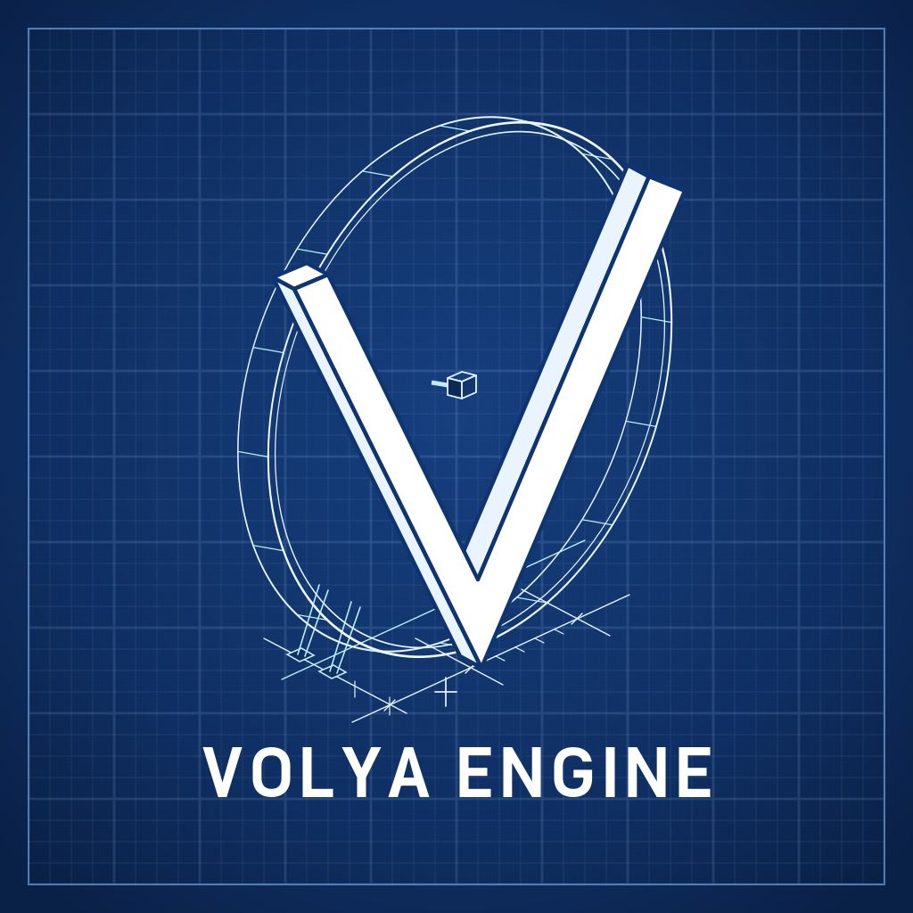

<p align="center"></p>

# Volya Engine

A clean-room, BYOA (bring your own assets) game engine for the original S.T.A.L.K.E.R. series, written in Rust. The first target is S.T.A.L.K.E.R.: Shadow of Chernobyl.

Volya Engine ships no game assets. You need your own legally obtained copy of the game.

Live version: https://mmotorny.github.io/volya-engine/

UX audit (every screen of the app, in each state, on each device): https://mmotorny.github.io/volya-engine/ux-audit/

## Clean room

Volya Engine's knowledge of the original game comes only from:

- the game's own data, as shipped in a legally obtained copy;
- analysis of the original game's shipped executables, for interoperability;
- public specifications of standard formats (DDS, Ogg Vorbis, Ogg Theora).

It does not use the leaked X-Ray engine source code or any project derived from it, such as OpenXRay. Investigators who analyze the game write functional specifications ([docs/formats](docs/formats), [docs/behavior](docs/behavior)); a reviewer admits a specification only if it contains no code, pseudo-code or internal names from the original; implementers write Volya Engine's code from those specifications alone. See [docs/clean-room.md](docs/clean-room.md).

## Platforms

Web (desktop Chrome; Chrome and Safari on iOS, installable as an iPhone Home Screen app), then native iOS and iPadOS, then VR. See [docs/roadmap.md](docs/roadmap.md).

## Running

Open the [live version](https://mmotorny.github.io/volya-engine/) in a supported browser.

To run locally on macOS:

1. Install [Bazelisk](https://github.com/bazelbuild/bazelisk) (`brew install bazelisk`): it runs the Bazel release `.bazelversion` names, which downloads the Rust toolchain, the crates and the wasm C compiler.
2. Build and serve:

   ```sh
   bazel run //tools/devserver
   ```

3. Open http://localhost:8080/volya-engine/ in Chrome.

## Development

- `bazel test //...`: the tests and static checks that run by default, cached (needs [`cargo-deny`](https://github.com/EmbarkStudios/cargo-deny) and Google Chrome).
- `bazel test //tests/browser:chrome //tests/browser:iphone`: every browser suite in headless Chrome and Mobile Safari in the iOS Simulator (needs Xcode).
- `bazel run //tools/xtask -- deploy`: publish to GitHub Pages.
- `bazel run //tools/xtask -- update`: move to the latest Rust, crates, Bazel and its rules.

See [docs/testing.md](docs/testing.md) and [docs/architecture/](docs/architecture/README.md).

## License

BSD-3-Clause. The vendored LuaJIT 1.0.3 (`crates/volya-engine-script/vendor/luajit-1.0.3`) and the files derived from it are MIT-licensed; see their notices. The Open Dynamics Engine 0.16.6 and its OU library, fetched and built from their release, are used under their BSD licence option (`platforms/web/static/third-party-licenses.txt`).

## Trademarks

Volya Engine is not affiliated with or endorsed by GSC Game World. S.T.A.L.K.E.R. is a trademark of its owner and is used here only to describe compatibility.
